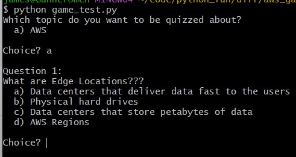

# AWS Practitioner Quiz (legacy terminal edition)

Original project and maintenance by **[@jmsgnnr](https://github.com/jmsgnnr)**.

This is an early Python learning project containing **26** Cloud Practitioner-style questions in one TOML bank. It remains a dependency-free terminal quiz on Python 3.11+; it does not connect to AWS, request credentials or incur AWS charges. For the newer browser-based study experience with Cloud Practitioner, Security and Advanced Networking tracks, see [CloudOps Lab](https://jmsgnnr.github.io/cloudops-lab/).

## Start and test

```sh
python game.py
python -m unittest discover -s tests -v
```

Choose the topic with its letter, then answer using letter labels. For multiple answers, separate letters with commas. Use `?` for a hint if shown, or `exit` to quit. Scoring is a percentage, not a fraction.

This repository is a **legacy study artifact**. Its 2023 question bank has not received a current AWS exam-objective or factual accuracy review and should not be treated as official certification material. No cloud API key is needed. The quiz implementation was originally informed by the [Real Python quiz application tutorial](https://realpython.com/python-quiz-application/), linked in the original notes below. Third-party tutorial rights remain with their authors.

---

## AWS :cloud: PRACTITIONER I QUIZ

### An Interactive quiz w/ our friend python :snake:

```py
Thanks for visiting our repo. 
If you stumbled upon this readme, 
we assume you're interested in learning more about AWS. 
Look No further. 
This quiz is for newbies looking to step into a new realm
as well as more experienced devs looking to learn the cloud.
really, this quiz is for everyone
We just want you to have fun while you learn.
We will try to lay out the next steps in the best way possible. 
Best of luck with your studies!!!!!
```

### 1. Open the quiz :book:

```sh
mkdir aws
cd aws
git clone https://github.com/jmsgnnr/aws_game.git
cd aws_game
code .
```

### 2.  Run the files :runner:

```sh
python game.py
```



*editor note: your terminal **SHOULD** look something like this ^*

### :bulb:Confused? Check out the docs:bulb:

- python :snake:
  - [Download](https://www.python.org/downloads/)
  - [Tutorial](https://docs.python.org/3/tutorial/)
- command line basics :computer:
  - [terminal-commands](https://realpython.com/terminal-commands/)
  - [basic-git-commands](https://confluence.atlassian.com/bitbucketserver/basic-git-commands-776639767.html)
  - [linux-for-beginners](https://maker.pro/linux/tutorial/basic-linux-commands-for-beginners)
- code editor (We recommend visual studio code) :pager:
  - [Visual Studio Code](https://code.visualstudio.com/download)
  - [vsc-python-tutorial](https://code.visualstudio.com/docs/python/python-tutorial)
- source code :information_source:
  - [learn-how-this-repo-was-built](https://realpython.com/python-quiz-application/)
  - [w3-schools-cloud-essentials](https://www.w3schools.com/quiztest/quiztest.php?qtest=AWSCE)
